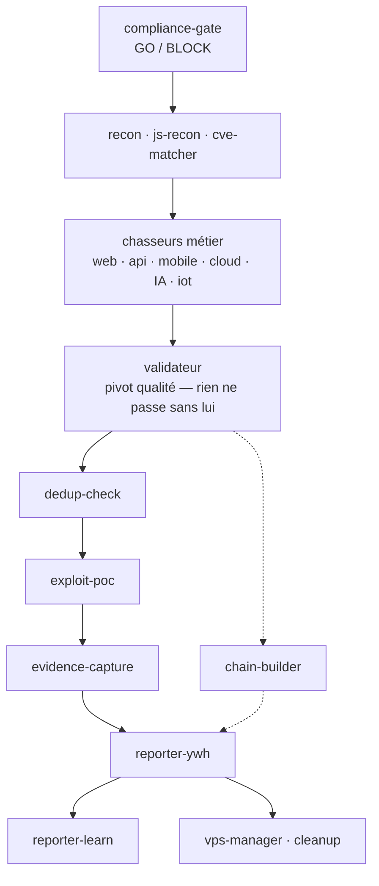

<h1 align="center">Cyber Hunt Toolkit</h1>

  Flotte de <b>31 subagents</b> (Claude Code) pour la chasse de vulnérabilités 
  sur programmes <b>bug bounty autorisés</b> — scope-gated, preuve minimale non destructive.

  
  
  
  
  
  

---

> **Usage autorisé uniquement.** Ce kit s'adresse à des cibles explicitement dans le scope d'un programme bug bounty autorisé (YesWeHack et assimilés), ou à tes propres labs / CTF. Aucun usage sur un système tiers sans autorisation.

Kit **portable** regroupant les **agents** et les **méthodes** — sans aucun compte rendu ni donnée de programme. Il s'installe « à blanc » : tu ajoutes tes propres cibles autorisées.

## Pipeline d'un run

## Les 31 agents

| Groupe | Agents |
|---|---|
| Méta / build | `meta-agent` → `cyber-builder` |
| Orchestration + garde-fous | `orchestrateur`, `compliance-gate`, `dedup-check` |
| Reconnaissance | `recon`, `js-recon`, `cve-matcher`, `scanner` |
| Chasseurs web | `web-auth`, `xss-hunter`, `idor-hunter`, `cors-clickjack`, `logic-abuse`, `secret-hunter` |
| Chasseurs API | `api-rest`, `graphql-hunter`, `ssrf-hunter` |
| Chasseurs spécialisés | `payment-logic`, `mobile-apk`, `llm-prompt-injection`, `cloud-misconfig`, `iot-router` |
| Validation / preuve | `validateur`, `exploit-poc`, `evidence-capture`, `chain-builder` |
| Rapports | `reporter-ywh`, `reporter-learn`, `triage-writer`, `vps-manager` |

## Gate de scope (règle centrale)

Avant **tout** test, chaque agent lit le scope du programme et rend un verdict :

- **IN_SCOPE** — la cible est explicitement listée, le test peut démarrer.
- **OUT_OF_SCOPE** — absente du scope ou exclue, STOP, aucun test.
- **UNCLEAR** — ambiguë, remontée à l'orchestrateur, jamais testée par défaut.

Le gate renvoie toujours : **verdict + ligne de scope citée + raison**.

## Contenu

- **`agents/`** — les 31 définitions de subagents. À installer dans `~/.claude/agents/`.
- **`cyber/`** — l'arborescence de travail (à installer dans `~/cyber/`) :
  - `targets/` — gate de scope : `README.md`, `_TEMPLATE-scope.md`, `INDEX.md` (table de lookup).
  - `knowledge/` — mémoire partagée templatée, vidée : `coverage-log.md`, `findings-log.md`, `patterns.md`, `lessons.md`, `playbooks/`, `custom-nuclei/`, `cve/`, `cwe/` (référentiel CWE générique).
  - `runs/` — un sous-dossier par run.
- **`INSTALL-PROMPT.md`** — prompt à coller dans Claude Code pour installer la flotte.

> **Non inclus (volontairement)** : aucune fiche de programme réel, aucun run, aucune entrée réelle de log. Le kit s'installe à blanc.

## Contrat de chemins

| Usage | Chemin |
|---|---|
| Scope d'un programme | `~/cyber/targets/<programme>.md` (+ lookup `INDEX.md`) |
| Mémoire partagée | `~/cyber/knowledge/coverage-log.md`, `patterns.md`, `findings-log.md` |
| Sorties d'un run | `~/cyber/runs/<programme>-<date>/` |

## Installation

Ouvre une session **Claude Code** à la racine de ce kit et suis [`INSTALL-PROMPT.md`](INSTALL-PROMPT.md) : il copie `agents/*` vers `~/.claude/agents/` et `cyber/*` vers `~/cyber/`, vérifie les 31 agents, et rappelle les règles de conduite. Ensuite, pour lancer une mission : invoque le subagent `orchestrateur` avec une cible autorisée.

## Règles de conduite (non négociables)

- Agir uniquement sur une cible explicitement **IN SCOPE** d'un programme autorisé. Hors scope / ambigu : `OUT_OF_SCOPE` / `UNCLEAR`, STOP.
- Preuve minimale, **non destructive**. Aucune donnée personnelle / financière réelle de tiers lue, copiée ou conservée.
- **Comptes de test uniquement.** Pas de DoS, bruteforce massif, exfiltration, persistance, mouvement latéral.
- Arrêt immédiat si erreurs en série, ralentissement visible, ou accès à des données tierces.

## Licence

[MIT](LICENSE) — usage strictement sur des programmes et cibles **autorisés**.
